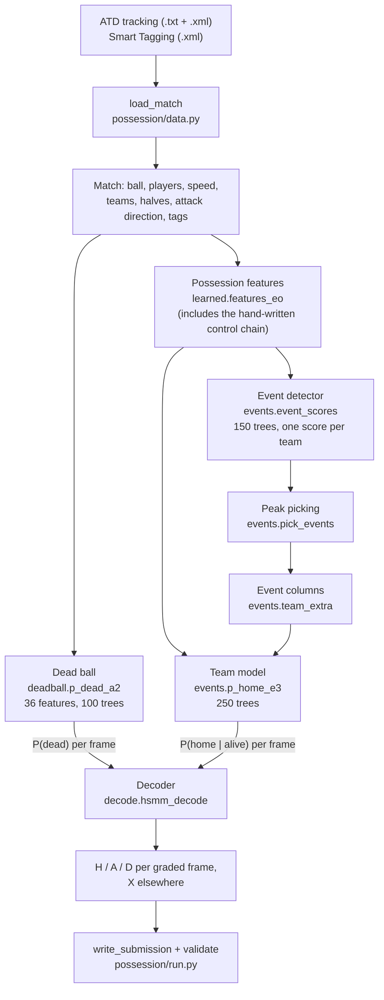

# How the pipeline runs

A code-level walkthrough of one run of the submitted pipeline, `integrated_v3`, from the provided
files to the CSV. Why each piece exists and how it was validated is in [TECHNICAL.md](TECHNICAL.md);
every parameter value and its origin is in [NOTES.md](NOTES.md).

```bash
python -m possession.run --out submissions/sport-motion.csv
```

## Overview



On a laptop the whole run takes about 30 s with a warm cache. Measured on BAR-ATH:

| stage | seconds |
|---|---|
| load the match (cached arrays) | 0.4 |
| dead-ball model | 3.4 |
| possession features | 1.9 |
| event-detector features | 1.2 |
| event scores + team model | 13.6 |
| decoder | 2.7 |

The first run on a machine also parses the 195 MB tracking file (about 10 s) and compiles the
decoder's inner loop with numba (a few seconds); both are cached afterwards.

## 1. Entry point: `possession/run.py`

`main()` parses `--pipeline` (default `pipelines.DEFAULT`, which is `integrated_v3`), `--out` and
`--list`. It then:

1. looks the pipeline up in the registry (`possession/pipelines/__init__.py`). Every module in
   `possession/pipelines/` is imported automatically and registers its functions with
   `@register("name")`;
2. loads the match (`load_match()`, step 2);
3. calls the pipeline, which returns one label code per video frame (H=0, A=1, D=2, X=3) and checks
   the array has exactly 199,319 entries;
4. writes the CSV and validates it with the organisers' own checks (step 8);
5. prints the label counts, the number of possessions in the graded halves and the file's SHA-256.

The pipeline itself is five lines (`possession/pipelines/integrated_v3.py`):

```python
base = learned.features_eo(match)                      # computed once, shared by two models
return decode.hsmm_decode(match,
                          deadball.p_dead_a2(match),   # P(ball dead) per frame
                          events.p_home_e3(match, base=base),   # P(home has it | ball alive)
                          evidence=0.2)
```

Every estimator reads only the `Match` object, never a file, so the same code runs unchanged on the
external validation games.

## 2. Loading the match: `possession/data.py`

`load_match()` builds a `Match`, a set of numpy arrays indexed by **video frame** (0 to 199,318):

| field | shape | content |
|---|---|---|
| `ball` | [n, 2] | ball x, y in pitch coordinates 0-1, NaN when not tracked |
| `players` | [n, 46, 2] | position of each of the 46 track slots, NaN when the slot is empty |
| `speed` | [n, 46] | each slot's speed in m/s as reported by the tracking |
| `slot_team` | [46] | 0 for home (Barcelona), 1 for away (Athletic) |
| `half` | [n] | 1 or 2 inside the graded halves, 0 elsewhere |
| `home_attacks_right` | {1, 2} | whether home attacks towards x = 1 in each half |
| `tags` | list | Smart Tagging intervals: code, start and end frame, team, type, half |
| `pitch` | (105.3, 68.0) | metres, for converting 0-1 coordinates |

How it is built:

- **Tracking.** The raw ATD line is `frame_id:slot;slot;...;slot:ball`, each group `x,y,speed`. The
  loader replaces `:` and `;` with `,` and parses the whole file in one pandas call with exact float
  parsing (`float_precision="round_trip"`), so every value matches what Python's `float()` would
  read. Row `frame_id` goes to index `frame_id - 1`. The arrays are cached in
  `cache/atd_BAR-ATH_tactical.npz`, keyed on the source files' size and modification time.
- **Teams and direction** come from the metadata XML: the first team listed is home, each slot's
  `teamId` gives its team, and `attack_direction_first_half` gives the direction (reversed in the
  second half).
- **Halves** come from `games.half_video_blocks`: video frames 11,185-90,651 and 110,808-190,197, the
  published graded blocks. Everything outside them is written as X.
- **Smart Tagging** intervals are converted with `round(seconds × 25)`. The team tag is mapped to H/A
  by club name; "N/A" becomes -1.

The homography and the video are not used by the submitted pipeline.

## 3. Dead ball: `deadball.p_dead_a2`

Output: for every graded frame, the probability that the ball is out of play.

**Features** (`frame_features2`, 36 columns, all computed from the tracking and tags):

- *Ball gaps* (`frame_features`, 11 columns): whether the ball is missing; how long the current gap
  is; how close the ball was to a touchline or goal line just before and just after the gap; whether
  a set-piece or goal tag overlaps the gap (±10 s); whether players slowed down during the gap
  relative to a rolling 60 s baseline; whether the visible ball is outside the lines or stationary;
  and whether the frame is before the detected kickoff.
- *Visible ball* (7): distance to a line, how far the ball moves in the next / previous second and
  over ±2 s, and whether it sits next to a player (held for a throw-in or free kick).
- *Collective stop* (6): share of players walking, team speed relative to its baseline over ±1 s
  and ±3 s, and the change from before to after the frame. When the referee stops play, everyone
  decelerates.
- *Context* (12):
  - share of missing-ball frames within ±3 s and ±10 s;
  - number of tracked objects now and around the frame, to tell a tracking outage from a stoppage;
  - for the previous and next ball gap: how far away, how long, and how close to a line;
  - how far into, and how far from the end of, the current gap.

**Kickoff detection** (`detect_kickoffs`) uses no frame numbers. Within each half it finds where
team speed rises to sustained play (10 s at 1.25× the half's median speed), walks back to the end of
the preceding lull, and accepts it only if, during the lull, at least 60 % of each team stand in
their own half. Frames before it are marked `pre_kickoff`.

**Model.** A boosted-tree ensemble (`possession/deadball_a2_model.npz`: 100 trees of depth 4,
stored as complete binary trees). `gbdt_predict` walks every tree in numpy: at each node a frame
goes right if `x[feature] > threshold`. The sum of leaf values becomes a probability through a
sigmoid.

**Post-processing.**
- Frames before the detected kickoff are forced to at least 0.98: the external games start at the
  kickoff, so the model never saw a pre-kickoff period.
- `clean_stretches`: alive holes shorter than 1.5 s inside a dead stretch are closed, and dead
  islands shorter than 1.5 s are removed.

## 4. Possession features: `learned.features_eo`

This step computes the inputs shared by the event detector and the team model. Its core is the
hand-written possession chain from `possession/emissions.py`.

**Preparation** (`emissions._prepare`):
- Ball and players are converted to metres.
- Gaps of up to 3 s in the ball track are linearly interpolated. That is used only to locate
  hand-overs; longer gaps stay missing.
- Velocities are central differences over ±2 frames.
- For each team: the distance from the ball to its nearest player, and that player's speed relative
  to the ball.

**Control rule** (`_control_frames`). A frame is control evidence for a team when its nearest player
is within 3 m of the ball, the nearest opponent is at least 1 m farther, and ball and player move
together (relative speed under 4 m/s). Frames where both teams are close give no evidence.

**Control episodes** (`_episodes`). Runs of evidence for one team, with interruptions of up to 5
frames bridged, that last at least 0.4 s. Shorter contacts are touches or deflections and are
ignored.

**Chain** (`_chain`). Between episodes the owner is the last team that had one. The confidence
decays with time since that control, through a two-state model whose mean spell is 13 s:
P(still the same team after d seconds) = 0.5 + 0.5·exp(−2d/13). Inside a ball gap, if the same team
controlled it on both sides it keeps it. If the teams differ, the hand-over is either placed where
the interpolated ball reaches the new team (gaps ≤ 3 s), or spread as a smooth probability over the
gap.

**Weak extra evidence**, added in log-odds:
- *Nearest team*: a soft vote, tanh((away distance − home distance) / 3 m), set to 0 when the ball
  is missing or moving faster than 15 m/s (in flight).
- *Team shape* (`shape_features`), measured in home's attacking direction and smoothed over 4 s:
  - how far up the pitch the two blocks are, and how fast that moves forward;
  - which team is more compact lengthwise, as the more compact team is usually pressing;
  - which team is wider;
  - which team is moving faster.

  Each feature changes sign when home and away are swapped. They are weighted by `SHAPE_W`, which
  was fitted on the external games.
- *Smart Tagging*: Build Up, Progression, Creating Chances, Attacking Transition, Ball in Final
  Third and Ball in the Box mean the tagged team has the ball; the Defending tags and Defensive
  Transition mean the other team has it.

Their sum, `z_b`, is the log-odds that home has the ball under the hand-written rules (the same
value `emissions.p_home_b` returns as a probability).

**The feature matrices.** `features_eo` returns two matrices:
- **10 even columns**, which don't change when home and away are swapped: ball visible, time
  since / until a control episode, inside an episode, gap length, nearest distance, ball speed,
  visible objects, players within 10 m, episode length.
- **25 odd columns**, which change sign under a swap: `z_b`, the chain's own logit, previous / next
  controller, the nearest-team vote, the distance difference, control balance in windows from ±0.5 s
  to ±6 s (past and future), the five shape features and their logit, the tag evidence, ball
  position along the attack axis, players near the ball (home minus away), and relative speed.

Several columns look up to 6 s into the future. The decoder later uses the whole half anyway.

## 5. Event detector: `events.event_scores` and `events.pick_events`

The detector estimates, for each frame and each team, the probability that the team **gains
controlled possession** within ±8 frames (0.32 s): a reception, a recovery or a restart.

**Features** (`event_features`):
- *even*: the 10 shared columns above, plus 10 ball-kinematics columns. Mean ball speed over the
  previous and next 8 frames and over 8-25 frames away; the change in speed; the size of the
  velocity change over 8 and 16 frames; the cosine and angle of the direction change; and the share
  of missing-ball frames within ±0.34 s.
- *own* (14 per team): distance of that team's nearest player now and at −0.5, −0.25, +0.25, +0.5
  and +1 s; its minimum over the previous and next half-second; relative speed now and averaged
  over ±0.4 s; teammates within 5 m and 3 m; and how much the distance closes over the second.
- *odd*: the 25 odd columns above, plus 8 away-minus-home distance differences at the same offsets.

**Scoring.** For "home gains control" the design matrix is `[even, own(home), own(away), +odd]`; for
"away gains control" it is `[even, own(away), own(home), −odd]`. One model serves both teams
(`possession/models/event_gbm.npz`: 150 trees, depth 5). `learned.predict_raw` evaluates it in
numpy, going left at each node when `x[feature] <= threshold`. A sigmoid gives the two score tracks
`sH` and `sA`.

**Peak picking** (`pick_events`). Each track is smoothed over ±0.12 s. A frame becomes an event if it
is the maximum within ±0.5 s and at least 0.2. Each event is a row (frame, team, confidence). On
BAR-ATH this gives 240 events across both halves.

**Event columns** (`team_extra`, 5 even + 9 odd), for every frame:
- seconds since the last and until the next event of either team, with those events' confidences;
- which team the last and next events belong to;
- the difference between the teams' times since and until their events;
- a confidence-weighted proximity to each team's nearest event;
- the windowed difference of the two score tracks (±0.5 s and ±2 s, past and future).

## 6. Team model: `events.p_home_e3`

The final P(home | ball alive) for each graded frame.

1. The inputs are concatenated: 15 even columns (10 + 5) and 34 odd columns (25 + 9), 49 in total.
2. `learned.assemble` builds the design matrix twice: as is, and **swapped**, with the odd columns
   negated, which is the same frame with the team labels exchanged. Values are rounded to 6
   decimals, so float noise can't flip a split near 0, and NaN becomes −999.
3. The model (`possession/models/team_gbm_ev.npz`: 250 trees, depth 5) scores both views.
4. The output is sigmoid(½·(z − z_swapped)). Averaging the two views makes the result exactly
   symmetric: swapping home and away gives 1 − p. So the model can't carry a home bias.

## 7. Decoder: `decode.hsmm_decode`

The decoder turns the two per-frame probabilities into whole possessions. Each half is decoded
separately; frames outside the halves are X.

**Per-frame evidence** (`evidence_ll`). For each frame and each state, the log-likelihood relative
to a prior with 30 % dead time:

- alive part: log((1 − P(dead)) / 0.7)
- H: alive part + log(P(home) / 0.5)
- A: alive part + log((1 − P(home)) / 0.5)
- D: log(P(dead) / 0.3)

Probabilities are clipped to [0.02, 0.98], so a single frame is never decisive, and everything is
multiplied by `evidence = 0.2`, because consecutive frames are strongly correlated. A frame with no
opinion contributes exactly zero to every state.

**Model.** An explicit-duration hidden Markov model (HSMM) over {H, A, D}:
- *Durations*: log-normal, median 8 s for possessions and 13 s for stoppages, with hard minimums of
  1 s and 3 s. Spells shorter than the minimum are impossible.
- *Transitions*:
  - from a possession, half of the exits go to the other team, at an extra cost of 1 nat, and half
    to a stoppage;
  - after a stoppage, either team restarts with equal prior; the evidence decides which.
- *Long spells*: segments are up to 80 s long, and longer spells continue as a same-state segment
  at a fixed cost. Same-state segments merge in the output.

**Solving.** `_hsmm_core`, compiled with numba, runs exact Viterbi over segments: for every frame and
state it keeps the best score of a segment ending there, trying every allowed duration. Backtracking
gives the single most likely sequence of possessions and stoppages for the whole half. Because the
whole half is solved at once, evidence after a frame can change the label before it.

**Boundary refinement** (`refine_boundaries`). Each boundary is moved within ±4 s to the split point
that maximises the unweighted evidence on both sides. Minimum durations stay respected. If the
evidence is flat, as inside a ball gap, the boundary goes to the middle of the flat stretch.

On BAR-ATH the result is 251 possessions, with 31.7 % of graded frames dead.

## 8. Writing and checking the file: `possession/run.py`

`write_submission` maps the codes to the letters `H A D X`, writes `frame,label` and one row per
frame with `\n` line endings, and writes the bytes in one go. `validate` re-reads the file with the
organisers' `possession_metrics.read_label_csv` and `validate_submission`, the same checks the
official scorer runs. A failure stops the run with the reason.

## Determinism

The same command gives a byte-identical file:
- nothing is random at inference;
- the tree models are evaluated in plain numpy from committed arrays, with inputs rounded before
  every comparison;
- the decoder is deterministic dynamic programming;
- the CSV is written with fixed formatting and line endings.

This has been checked by two runs on the same machine and by a fresh copy with a new virtual
environment built from `requirements.txt` only, on Windows. Linux and macOS have not been checked.

## Model files

| file | used by | size | trees | regenerated by |
|---|---|---|---|---|
| `possession/deadball_a2_model.npz` | `deadball.p_dead_a2` | 23 KB | 100, depth 4 | `scripts/train_deadball_a2.py` |
| `possession/models/event_gbm.npz` | `events.event_scores` | 138 KB | 150, depth 5 | `scripts/train_events.py final` |
| `possession/models/team_gbm_ev.npz` | `events.p_home_e3` | 324 KB | 250, depth 5 | `scripts/train_events.py final` |

Training needs the external games (`python -m extval.datasets`, `extval.dfl.download()`) and
`requirements-train.txt` (LightGBM 4.7.0, single-threaded, fixed seeds). Producing the submission
needs neither.

## Other pipelines and tools

- `python -m possession.run --list` shows every registered pipeline. Besides `integrated_v3`:
  - `integrated_v1`: rules only, the logistic dead-ball model with `p_home_b`;
  - `integrated_v2`: the learned dead ball and team model without the event detector;
  - `integrated_v4`, `integrated_v4_a2m`: retrained on Metrica plus the Bundesliga matches, not
    submitted;
  - the starter baselines.
- `python -m extval.harness --pipeline <name>` scores any pipeline on the degraded external games
  with the official metric code.
- `python video/render_overlay.py --at mm:ss --seconds 60` draws the tracking and a submission's
  labels on a clip of the tactical video. It needs the video environment in `video/requirements.txt`.
